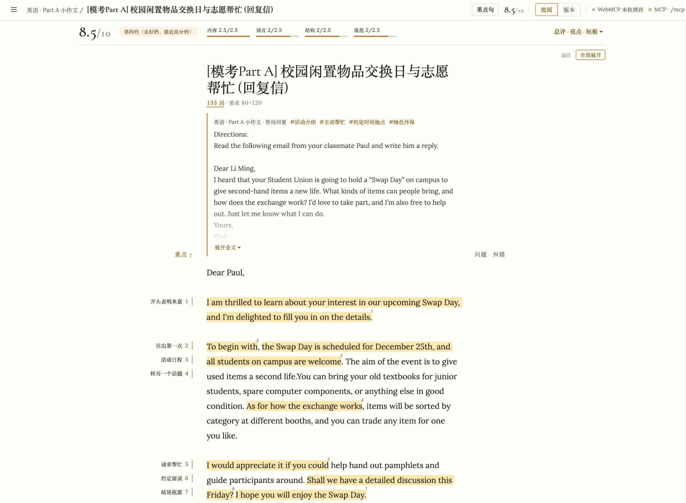

# EssayPilot · 考研作文批阅台

在一个页面里写考研英语作文和政治大题，把评分、纠错、标重点交给你自己的 AI Agent（Claude Code、Codex 等）。Agent 的每一步改动都会实时出现在页面上。



## 能做什么

- **边写边标**：选中正文就能标为重点、亮点、问题或疑问，并附一句边注。左侧页边放重点和亮点，右侧放问题和纠错；「全部展开」可以看每条边注的全文。边注支持 Markdown。
- **让 Agent 评分**：按考研阅卷标准给出总分、档次、四个维度的分数、总评、亮点与短板，并附一份润色稿。
- **一键采纳纠错**：Agent 的修改建议挂在原文旁边，点「采纳」就替换正文。
- **积累重点句**：Agent 只标能复用的开头句、结尾句、承接过渡句和万能句型，页边写使用场景（如「开头表明来意」「转另一个话题」）。顶栏「重点句」页汇总所有作文的重点句，可搜索、按分类或场景分组，点一句跳回原文。
- **回答你的疑问**：在正文上标个「疑问」，让 Agent 逐条回复。
- **版本对照**：每次评分自动存一个版本；任意两个版本之间，或当前稿与润色稿之间都能逐词对比，也能整篇采纳。
- **题目随手改**：题目要求直接显示在标题下方，点一下就能修改题型、分类、标签和题目，也能粘贴题目图片。

## 开始使用

用 Homebrew（macOS / Linux）安装，并作为后台服务运行：

```bash
brew install wesleyel/tap/essaypilot
brew services start essaypilot
```

也可以从源码运行（需要 Go 1.26 及以上），或在 [Releases](https://github.com/wesleyel/EssayPilot/releases) 下载对应平台的程序：

```bash
git clone https://github.com/wesleyel/EssayPilot && cd EssayPilot
go install ./cmd/essaypilot
essaypilot -mcp
```

打开 http://127.0.0.1:8790 ，然后把 Agent 接上。以 Claude Code 为例：

```bash
claude mcp add --transport http essaypilot http://127.0.0.1:8790/mcp
```

## 日常用法

1. 点左上角的列表按钮，「新建」一篇作文，选科目、题型、分类，填题目要求，再写正文。
2. 写完对 Agent 说「给我正在看的这篇评分」，或者在页面底部点「复制 grade_essay」，把提示词粘贴给任何一个 Agent。
3. 想积累好句子，就让它「给这篇标重点」（提示词 `mark_highlights`）；有疑问就在正文上标「疑问」，再让它「回答我的标记」（`review_my_marks`）。只想改语言不打分，用 `polish_essay`。
4. 在右侧逐条采纳纠错，或在「版本」页对照润色稿后整篇采纳。
5. 复习时打开「重点句」页，按场景翻看攒下来的句子。

Agent 每次调用了什么工具、此刻看到你选中了哪段，都显示在页面底部。

## 启动参数

| 参数 | 默认值 | 说明 |
| --- | --- | --- |
| `-addr` | `127.0.0.1:8790` | 监听地址 |
| `-db` | `essaypilot.db` | 数据文件，备份时复制这个文件即可 |
| `-mcp` | 关 | 开启 Agent 接入（`/mcp`） |
| `-token` | `$ESSAYPILOT_TOKEN` | 访问令牌。监听非本机地址时必须设置，浏览器用 `http://host:port/#token=<令牌>` 打开 |

Agent 可用的工具、提示词和 REST 接口见 [docs/api.md](docs/api.md)。

## 许可

[MIT](LICENSE)
